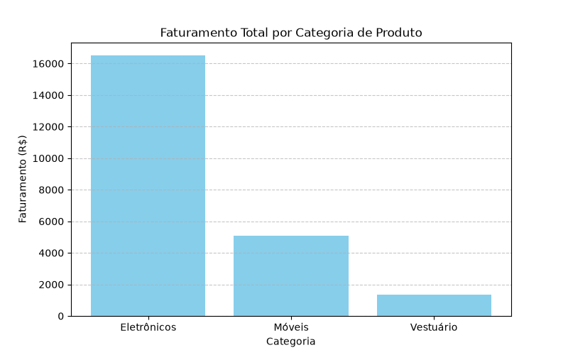

# Análise de Vendas de E-commerce 📊

Este é um projeto simples de análise de dados desenvolvido em Python para consolidar os resultados de vendas de uma loja fictícia.

## 🚀 Funcionalidades
- Importação e tratamento de dados estruturados em formato `.csv`.
- Cálculo automático de indicadores-chave (Faturamento Total, Produto Mais Vendido e Região Líder).
- Geração de gráfico visual de faturamento por categoria de produto.

## 🛠️ Tecnologias Utilizadas
- **Python 3**
- **Pandas** (para manipulação de dados)
- **Matplotlib** (para visualização de dados)

## 📈 Como Executar o Projeto
1. Certifique-se de ter as bibliotecas instaladas: `pip install pandas matplotlib`
2. Execute o arquivo principal: `python analise.py`

## 📊 Visualização dos Dados

